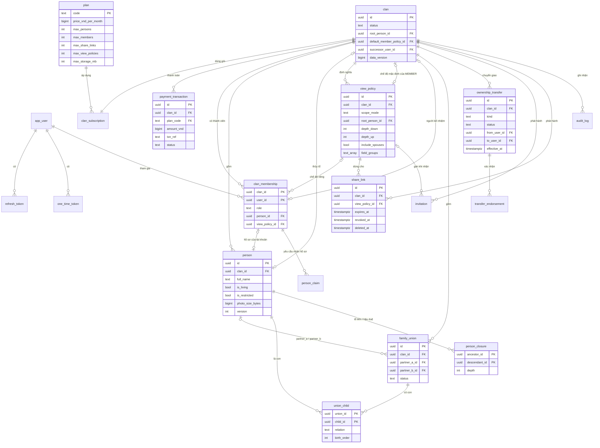

# Mô hình dữ liệu

| Thuộc tính | Giá trị |
|---|---|
| Mã tài liệu | GP-DOC-02 |
| Phiên bản | 1.1 |
| Ngày ban hành | 14/10/2026 |
| Tài liệu liên quan | GP-DOC-01 Phạm vi, GP-DOC-03 Phân quyền, GP-DOC-04 Gói dịch vụ, GP-DOC-05 Quản trị và chuyển giao, `db/migration/` |

## 1. Phạm vi và nguyên tắc

Tài liệu mô tả mô hình dữ liệu của hệ thống và lý do thiết kế. Định nghĩa chuẩn của lược đồ là các tệp
migration Flyway trong `db/migration/`. Khi tài liệu và migration có sai khác, migration có giá trị áp dụng;
tài liệu được cập nhật trong cùng pull request với migration.

## 2. Danh mục thực thể

| Nhóm | Bảng | Thuộc dòng họ | Mô tả |
|---|---|---|---|
| Tài khoản | `app_user` | Không | Tài khoản; `system_role` (SYSTEM_ADMIN, SUPPORT), `email_verified_at`, `last_active_at` |
| | `refresh_token` | Không | Phiên đăng nhập; lưu SHA-256 của token |
| | `one_time_token` | Không | Token xác minh email, đặt lại mật khẩu, OTP xác thực bổ sung; lưu SHA-256 |
| | `email_outbox` | Không | Hàng đợi email nghiệp vụ |
| Nền tảng | `plan` | Không | Gói dịch vụ: giá, hạn mức, cờ tính năng |
| | `system_setting` | Không | Cấu hình hệ thống dạng khóa – giá trị |
| | `admin_audit_log` | Không | Nhật ký thao tác quản trị nền tảng |
| Dòng họ | `clan` | Là tenant | Dòng họ; thủy tổ, chế độ xem mặc định, người kế nhiệm, trạng thái, phiên bản dữ liệu |
| | `clan_subscription` | Có | Gói đang áp dụng và thời điểm hết hạn |
| | `payment_transaction` | Có | Giao dịch thanh toán |
| Gia phả | `person` | Có | Một người trong gia phả |
| | `family_union` | Có | Một hôn phối, hoặc gia đình một bên khi không xác định được cha hoặc mẹ |
| | `union_child` | Có | Quan hệ giữa người con và hôn phối: con đẻ hoặc con nuôi, thứ tự sinh |
| | `person_closure` | Có | Toàn bộ cặp (tổ tiên, hậu duệ) kèm số đời; do trigger duy trì |
| Truy cập | `view_policy` | Có | Chế độ xem: phạm vi và nhóm trường |
| | `clan_membership` | Có | Quan hệ người dùng – dòng họ: vai trò, chế độ xem riêng, hồ sơ gắn với tài khoản |
| | `invitation` | Có | Lời mời tham gia; lưu SHA-256 của token |
| | `share_link` | Có | Link chia sẻ; lưu SHA-256 của token; xóa mềm |
| | `person_claim` | Có | Yêu cầu nhận hồ sơ |
| | `ownership_transfer` | Có | Yêu cầu chuyển giao quyền trưởng tộc |
| | `transfer_endorsement` | Có | Xác nhận của EDITOR cho đơn khôi phục |
| | `audit_log` | Có | Nhật ký chỉ ghi thêm |

## 3. Sơ đồ thực thể – liên kết

## 4. Quan hệ gia đình

Người con được gắn vào **hôn phối**, không gắn trực tiếp vào từng người cha hoặc mẹ (tương tự mô hình FAM của GEDCOM).
Mô hình này phân biệt được con của từng hôn phối khi một người có nhiều vợ hoặc chồng. Cơ sở lựa chọn: ADR-0002.

| Tình huống | Cách biểu diễn |
|---|---|
| Ông An có hai vợ là bà Bé và bà Cúc | `family_union(An, Bé, partner_a_order=1)`, `family_union(An, Cúc, partner_a_order=2)` |
| Con của ông An và bà Bé | `union_child(hôn phối An–Bé, Bình, BIOLOGICAL, birth_order=1)` |
| Con nuôi | `union_child(..., relation=ADOPTED)` |
| Chỉ xác định được mẹ | `family_union(Chi, NULL)`, người con gắn vào hôn phối này |
| Ly hôn, góa | `family_union.status = DIVORCED` hoặc `WIDOWED` |
| Hôn nhân giữa người có quan hệ họ hàng | Hợp lệ; đồ thị có nhiều đường đi, closure lưu số đời ngắn nhất |

Ràng buộc được cơ sở dữ liệu bảo đảm:
- Mỗi người có tối đa một gia đình đẻ; số gia đình nuôi không giới hạn.
- Không tồn tại người là tổ tiên của chính mình (`person_no_ancestry_cycle`).
- Mỗi cặp vợ chồng có duy nhất một bản ghi hôn phối.
- Không xóa được người còn quan hệ hoặc hôn phối còn con. Quan hệ phải được gỡ trước; API trả 409 `HAS_RELATIONS`.

**Đời (generation)** không được lưu trữ mà được tính bằng `min(depth) + 1` từ thủy tổ trong `person_closure`.
Vợ hoặc chồng không thuộc huyết thống lấy đời của người phối ngẫu. Người chưa được nối vào cây có đời bằng `null`.

## 5. Ngày tháng âm lịch và dương lịch

### 5.1. Cấu trúc

Mỗi sự kiện (sinh, mất) gồm **hai giá trị độc lập**: dương lịch và âm lịch, mỗi giá trị có độ chính xác riêng.
Cơ sở lựa chọn: ADR-0003.

| `precision` | year | month | day | Hiển thị |
|---|---|---|---|---|
| `UNKNOWN` | — | — | — | "Chưa rõ" |
| `YEAR` | ✓ | — | — | "1890", "khoảng 1890" |
| `MONTH` | ✓ | ✓ | — | "tháng 3/1890" |
| `DAY` | ✓ | ✓ | ✓ | "12/3/1890" |

Quy tắc hợp lệ:
- `approximate` ("khoảng") áp dụng cho mọi mức trừ `UNKNOWN`.
- `leapMonth` (tháng nhuận) chỉ có ở âm lịch và chỉ với mức `MONTH` hoặc `DAY`.
- Ngày dương lịch mức `DAY` phải là ngày tồn tại trên lịch. Ngày âm lịch mức `DAY` nằm trong khoảng 1–30;
  độ dài thực tế của tháng âm (29 hoặc 30 ngày) và sự tồn tại của tháng nhuận được backend kiểm tra bằng thuật toán lịch.
- Người có `is_living = true` không có ngày mất.

### 5.2. Nhập liệu và quy đổi

- Người dùng nhập ngày theo một loại lịch; nút "Tự tính" điền ngày ở loại lịch còn lại thông qua API quy đổi.
  Nút chỉ được bật khi ngày đã nhập ở mức `DAY`. Ở mức `YEAR` hoặc `MONTH`, hai loại lịch không quy đổi được
  một cách xác định do năm âm lịch và năm dương lịch lệch nhau quanh Tết.
- Quy đổi theo lịch Việt Nam tính tại múi giờ UTC+7 (thuật toán Hồ Ngọc Đức), trong khoảng năm 1800–2199.
  Lịch Trung Quốc (UTC+8) lệch với lịch Việt Nam ở một số năm; hệ thống không sử dụng thư viện lịch Trung Quốc.
- Frontend không cài đặt thuật toán quy đổi; mọi phép quy đổi được thực hiện qua API.
- Can chi được suy ra từ năm âm lịch và không được lưu: can là phần tử thứ `(năm + 6) mod 10` của
  [Giáp, Ất, Bính, Đinh, Mậu, Kỷ, Canh, Tân, Nhâm, Quý]; chi là phần tử thứ `(năm + 8) mod 12` của
  [Tý, Sửu, Dần, Mão, Thìn, Tỵ, Ngọ, Mùi, Thân, Dậu, Tuất, Hợi]. Ví dụ: năm 1890 là Canh Dần.

### 5.3. Kiểm tra khớp âm lịch – dương lịch

Backend kiểm tra sự nhất quán giữa hai giá trị ở mọi yêu cầu ghi dữ liệu. Mỗi giá trị biểu diễn một khoảng ngày
dương lịch: mức `DAY` là một ngày, mức `MONTH` là cả tháng, mức `YEAR` là cả năm. Đối với âm lịch, năm Y kéo dài
từ ngày Tết năm Y đến ngày trước Tết năm Y+1; tháng âm kéo dài từ ngày sóc đến ngày trước ngày sóc của tháng kế tiếp.

**Hai khoảng phải giao nhau.** Trường hợp không giao nhau, API trả 422 `DATE_CALENDAR_MISMATCH` với
`errors[].field` là `birth` hoặc `death`. Khi cả hai giá trị ở mức `DAY`, hai ngày phải trùng nhau hoàn toàn,
bao gồm cờ tháng nhuận. Việc kiểm tra được bỏ qua khi một trong hai giá trị là `UNKNOWN`, có `approximate = true`,
hoặc nằm ngoài khoảng năm 1800–2199.

| Dương lịch | Âm lịch | Kết quả |
|---|---|---|
| 17/02/2026 (`DAY`) | Mùng 1 tháng Giêng năm 2026 (`DAY`) | Hợp lệ (Tết Bính Ngọ) |
| 17/02/2026 (`DAY`) | Năm 2025 (`YEAR`) | Từ chối: ngày này thuộc năm âm lịch 2026 |
| Năm 1890 (`YEAR`) | Năm 1889 (`YEAR`) | Hợp lệ: tháng 1/1890 dương lịch thuộc năm âm lịch 1889 |
| Năm 1890 (`YEAR`) | Năm 1887 (`YEAR`) | Từ chối |
| Khoảng năm 1890 (`YEAR`, approximate) | Năm 1887 (`YEAR`) | Không kiểm tra |

Bộ test của chức năng quy đổi bắt buộc bao gồm trường hợp Tết Ất Sửu 1985: theo lịch Việt Nam là ngày 21/01/1985,
theo lịch Trung Quốc là ngày 20/02/1985.

### 5.4. Lưu trữ

Mỗi giá trị ngày được lưu thành một nhóm cột (`birth_solar_precision`, `birth_solar_year`, ...). Tầng ánh xạ
sử dụng `@Embeddable SolarDate` và `@Embeddable LunarDate` kết hợp `@AttributeOverride`.

## 6. Bảng closure

`person_closure` lưu toàn bộ cặp (tổ tiên, hậu duệ), bao gồm cặp (X, X, 0). Bảng phục vụ ba mục đích:
kiểm tra phạm vi trong RLS, tính đời, và xác định quan hệ họ hàng (chức năng S02).

- Chỉ trigger được ghi vào bảng; tầng ứng dụng chỉ có quyền `SELECT`.
- Khi `union_child` thay đổi, hoặc khi người trong `family_union` thay đổi, closure của dòng họ liên quan được
  dựng lại bằng truy vấn đệ quy. Truy vấn này đồng thời phát hiện quan hệ tổ tiên vòng và hủy transaction.
- Phương án dựng lại toàn bộ dòng họ được chọn vì tính đơn giản và đúng đắn; chi phí ghi được đánh giá theo
  điều kiện tại ADR-0004.

## 7. Chế độ xem và gắn tài khoản với hồ sơ

`view_policy` mô tả một cách xem dữ liệu: phạm vi và nhóm trường. Quy tắc áp dụng cho từng vai trò được quy định
tại GP-DOC-03 mục 4–5.

| `scope_mode` | `root_person_id` | `depth_down`, `depth_up` | Ý nghĩa |
|---|---|---|---|
| `CLAN` | — | — | Toàn bộ dòng họ |
| `BRANCH` | Bắt buộc | Bắt buộc (0–50) | Hậu duệ của người gốc trong `depth_down` đời và tổ tiên trong `depth_up` đời |
| `RELATIVE` | — | Bắt buộc (0–50) | Tổ tiên của người xem trong `depth_up` đời và hậu duệ của các tổ tiên đó tới `depth_down` đời dưới thế hệ người xem |

- `field_groups` bắt buộc chứa `BASIC` và không chứa `IDENTITY_DOCS`.
- `clan.default_member_policy_id` là chế độ xem mặc định của MEMBER; `clan_membership.view_policy_id` ghi đè cho từng người.
- `share_link.view_policy_id` là bắt buộc. Trigger bảo đảm chế độ xem của link chưa xóa không có phạm vi `RELATIVE`
  và chỉ gồm nhóm trường trong trần của link (`share_link_policy_ceiling`), kể cả khi chế độ xem bị sửa sau đó.
- `clan_membership.person_id` gắn tài khoản với hồ sơ. Chỉ mục duy nhất bảo đảm một hồ sơ gắn với tối đa một tài khoản
  trong mỗi dòng họ. Việc gắn diễn ra qua lời mời có `invitation.person_id`, qua yêu cầu `person_claim` được duyệt,
  hoặc do OWNER cập nhật trực tiếp.

## 8. Trưởng tộc và chuyển giao

- Chỉ mục duy nhất `clan_membership_one_owner_uk` cùng trigger `clan_membership_owner_guard` bảo đảm mỗi dòng họ có
  **đúng một** OWNER.
- `clan.successor_user_id` là người kế nhiệm, tham chiếu `clan_membership`; khi thành viên này rời dòng họ, giá trị tự về `NULL`.
- `ownership_transfer` lưu mọi yêu cầu chuyển giao với loại (`VOLUNTARY`, `SUCCESSOR`, `RECOVERY`) và trạng thái.
  Mỗi dòng họ có tối đa một yêu cầu đang xử lý (`ownership_transfer_one_active_uk`). Sơ đồ trạng thái tại GP-DOC-05 mục 5.
- Các ngưỡng thời gian lấy từ `system_setting`: `OWNER_INACTIVE_DAYS`, `TAKEOVER_WAIT_DAYS`, `TRANSFER_ACCEPT_DAYS`,
  `RECOVERY_ENDORSE_DAYS`.

## 9. Gói dịch vụ, hạn mức và thanh toán

- Gói hiệu lực của dòng họ là gói trong `clan_subscription` khi còn hạn, ngược lại là `FREE` (hàm `gp_effective_plan`).
- Hạn mức về số người, số thành viên, số link đang hoạt động và số chế độ xem được kiểm tra bằng trigger `BEFORE INSERT`;
  dung lượng ảnh được kiểm tra khi `photo_size_bytes` tăng. Các trigger dùng khóa tư vấn theo (tài nguyên, dòng họ)
  để hai yêu cầu đồng thời không vượt hạn mức. Vượt hạn mức phát sinh SQLSTATE `GP010`.
- `payment_transaction.txn_ref` là mã giao dịch gửi sang VNPay, duy nhất trên toàn hệ thống. Chi tiết luồng thanh toán
  tại GP-DOC-04.

## 10. Phiên bản dữ liệu dòng họ

`clan.data_version` tăng mỗi khi `person`, `family_union` hoặc `union_child` của dòng họ thay đổi (trigger cấp câu lệnh).
Giá trị này là thành phần của khóa cache dữ liệu cây (ADR-0009): dữ liệu thay đổi thì khóa thay đổi, mục cache cũ
không còn được đọc.

## 11. Toàn vẹn giữa các dòng họ

Mọi bảng thuộc dòng họ có cột `clan_id`. Khóa ngoại giữa các bảng này là **khóa kép** `(clan_id, id)`,
ví dụ `union_child(clan_id, child_id) → person(clan_id, id)`. Cơ sở dữ liệu do đó từ chối mọi tham chiếu
giữa hai dòng họ khác nhau, kể cả khi người thực hiện là `OWNER` của cả hai. Trigger ngăn mọi thao tác thay đổi `clan_id`.

## 12. Quy ước cho tầng ứng dụng

- Khóa chính UUID được sinh tại tầng ứng dụng (`@GeneratedValue(strategy = GenerationType.UUID)`), không sử dụng
  giá trị mặc định của cơ sở dữ liệu. Lý do: `INSERT ... RETURNING` bị RLS từ chối đối với `EDITOR` có phạm vi
  giới hạn (test T20).
- Kiểu liệt kê được lưu dạng `text` kèm `CHECK` và ánh xạ bằng `@Enumerated(EnumType.STRING)`.
- Cột `version` ánh xạ bằng `@Version` (optimistic locking). Cột `updated_at` do trigger cập nhật.
- Cấu hình `spring.jpa.hibernate.ddl-auto=validate`. Lược đồ chỉ thay đổi qua migration Flyway mới;
  migration đã merge không được sửa.
- Kiểu `timestamptz` ánh xạ sang `Instant` hoặc `OffsetDateTime`.
- Tài khoản `gp_app` được cấp quyền UPDATE theo cột. Các cột dưới đây được ánh xạ với
  `@Column(insertable = false, updatable = false)`; giá trị chỉ thay đổi qua hàm cơ sở dữ liệu hoặc trigger:

  | Bảng | Cột |
  |---|---|
  | `app_user` | `status`, `system_role`, `last_active_at`, `created_at`, `updated_at` |
  | `clan` | `status`, `successor_user_id`, `data_version`, `created_by`, `created_at`, `updated_at` |
  | `clan_membership` | `clan_id`, `user_id`, `created_by`, `created_at`, `updated_at` |

- Kiểu `text[]` (`view_policy.field_groups`) ánh xạ bằng `@JdbcTypeCode(SqlTypes.ARRAY)`.

## Lịch sử thay đổi

| Phiên bản | Ngày | Nội dung |
|---|---|---|
| 1.0 | 14/10/2026 | Ban hành lần đầu |
| 1.1 | 14/10/2026 | Bổ sung chế độ xem, gắn tài khoản với hồ sơ, chuyển giao trưởng tộc, gói dịch vụ và thanh toán, phiên bản dữ liệu, quyền theo cột |
