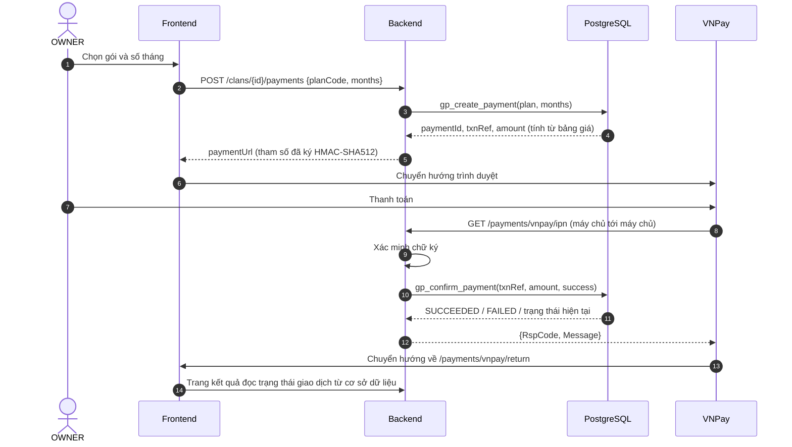

# Gói dịch vụ, hạn mức và thanh toán

| Thuộc tính | Giá trị |
|---|---|
| Mã tài liệu | GP-DOC-04 |
| Phiên bản | 1.0 |
| Ngày ban hành | 14/10/2026 |
| Tài liệu liên quan | GP-DOC-01 Phạm vi, GP-DOC-02 Mô hình dữ liệu, ADR-0007, `db/migration/V3__reference_data.sql` |

## 1. Phạm vi

Tài liệu quy định danh mục gói dịch vụ, cơ chế áp dụng hạn mức, vòng đời đăng ký gói và luồng thanh toán
qua VNPay. Hệ thống sử dụng môi trường sandbox của VNPay; việc chuyển sang môi trường thật chỉ thay đổi cấu hình.

## 2. Danh mục gói

Giá trị khởi tạo trong `V3__reference_data.sql`; `SYSTEM_ADMIN` điều chỉnh được qua `PUT /admin/plans/{planCode}`.

| | FREE | STANDARD | PREMIUM |
|---|---|---|---|
| Giá (VND/tháng) | 0 | 49.000 | 149.000 |
| Số người tối đa | 300 | 3.000 | 20.000 |
| Số thành viên (tài khoản) | 10 | 100 | 1.000 |
| Số link chia sẻ đang hoạt động | 2 | 20 | 200 |
| Số chế độ xem | 1 | 10 | 50 |
| Dung lượng ảnh | 200 MB | 5 GB | 50 GB |
| Xuất Excel | ✗ | ✓ | ✓ |
| Nhập Excel (S01) | ✗ | ✗ | ✓ |
| Quan hệ họ hàng (S02) | ✗ | ✓ | ✓ |
| Thời gian lưu audit | 30 ngày | 365 ngày | 1.825 ngày |
| Mua được | Không (mặc định) | Có | Có |

## 3. Áp dụng hạn mức

| Loại | Vị trí kiểm tra | Phản hồi khi vi phạm |
|---|---|---|
| Số người, số thành viên, số link đang hoạt động, số chế độ xem | Trigger `BEFORE INSERT` trong cơ sở dữ liệu, có khóa tư vấn theo (tài nguyên, dòng họ) | 402 `QUOTA_EXCEEDED`, kèm `quota.resource` và `quota.limit` |
| Dung lượng ảnh | Trigger khi `photo_size_bytes` tăng; backend kiểm tra trước khi lưu tệp | 402 `QUOTA_EXCEEDED` |
| Tính năng (xuất Excel, nhập Excel, quan hệ họ hàng) | Backend, dựa trên `gp_clan_entitlements()` | 402 `FEATURE_NOT_IN_PLAN` |
| Thời gian lưu audit | Tác vụ bảo trì `gp_purge_expired_data()` | Không áp dụng |

Việc kiểm tra số lượng đặt tại cơ sở dữ liệu bảo đảm hai yêu cầu đồng thời không vượt hạn mức, điều mà kiểm tra
tại tầng ứng dụng không bảo đảm được.

## 4. Vòng đời đăng ký

- Dòng họ mới bắt đầu ở gói FREE, không thời hạn.
- Gói hiệu lực là gói đã đăng ký khi `current_period_end` còn hạn hoặc bằng `NULL`; ngược lại là FREE.
- Mua **cùng gói** khi gói còn hạn: thời gian được cộng thêm vào `current_period_end`.
- Mua **gói khác**, hoặc mua khi gói đã hết hạn: kỳ mới bắt đầu tại thời điểm thanh toán thành công. Thời gian còn
  lại của gói cũ không được quy đổi.
- **Hết hạn hoặc hạ gói không xóa dữ liệu.** Dòng họ trở về hạn mức FREE; tài nguyên đã vượt hạn mức vẫn được giữ và
  xem được, chỉ thao tác tạo mới tài nguyên đó bị chặn.
- `SYSTEM_ADMIN` cấp hoặc điều chỉnh gói thủ công qua `PUT /admin/clans/{clanId}/subscription` (hỗ trợ, hoàn tiền
  ngoài hệ thống); thao tác được ghi vào nhật ký quản trị và audit của dòng họ.

## 5. Luồng thanh toán VNPay

Tham số tạo URL thanh toán: `vnp_Version=2.1.0`, `vnp_Command=pay`, `vnp_TmnCode`, `vnp_Amount` (số tiền × 100),
`vnp_CurrCode=VND`, `vnp_TxnRef`, `vnp_OrderInfo`, `vnp_OrderType`, `vnp_Locale=vn`, `vnp_ReturnUrl`, `vnp_IpAddr`,
`vnp_CreateDate`, `vnp_ExpireDate` (15 phút). Chữ ký `vnp_SecureHash` là HMAC-SHA512 của chuỗi tham số đã sắp xếp
theo tên, dùng khóa bí mật của merchant.

Cấu hình (biến môi trường, không lưu trong kho mã): `VNPAY_TMN_CODE`, `VNPAY_HASH_SECRET`, `VNPAY_PAY_URL`,
`VNPAY_RETURN_URL`.

## 6. Xử lý IPN

IPN là nguồn duy nhất kích hoạt gói. Backend xử lý theo thứ tự:

| Bước | Điều kiện thất bại | `RspCode` |
|---|---|---|
| 1. Xác minh chữ ký (so sánh thời gian hằng) | Chữ ký sai | `97` |
| 2. Tìm giao dịch theo `vnp_TxnRef` | Không tìm thấy (`GP020`) | `01` |
| 3. So khớp số tiền (`vnp_Amount / 100`) | Không khớp (`GP021`) | `04` |
| 4. Giao dịch đã kết thúc trước đó | `gp_confirm_payment` trả trạng thái đã kết thúc | `02` |
| 5. Ghi kết quả: thành công khi `vnp_ResponseCode = 00` và `vnp_TransactionStatus = 00` | Lỗi khác | `99` |
| Thành công | | `00` |

- IPN luôn nhận phản hồi HTTP 200; mã kết quả nằm trong body theo đặc tả VNPay.
- `gp_confirm_payment` khóa dòng giao dịch (`FOR UPDATE`) và xử lý idempotent: IPN lặp lại không cộng thời gian lần thứ hai (T33).
- Mọi IPN được ghi log ứng dụng kèm `vnp_TxnRef`, kết quả xác minh và `RspCode` trả về.
- Trang trả về (`/payments/vnpay/return`) chỉ xác minh chữ ký và chuyển hướng tới trang kết quả; không thay đổi trạng thái.

## 7. Đối soát và hết hạn

- Giao dịch `PENDING` quá 60 phút được chuyển sang `EXPIRED` (`gp_expire_pending_payments`, tác vụ định kỳ 10 phút).
- IPN thành công đến sau khi giao dịch đã `EXPIRED` vẫn được ghi nhận và kích hoạt gói, do khách hàng đã thanh toán.
- Đối soát chủ động bằng API truy vấn giao dịch của VNPay cho giao dịch `PENDING` quá 15 phút là chức năng mở rộng.

## 8. Yêu cầu bảo mật

1. Số tiền luôn do máy chủ tính từ bảng `plan`; yêu cầu tạo giao dịch không chứa số tiền.
2. Khóa bí mật HMAC chỉ tồn tại trong biến môi trường của backend.
3. Chỉ IPN đã xác minh chữ ký mới thay đổi trạng thái giao dịch và gói.
4. Hệ thống không tiếp nhận, không lưu thông tin thẻ; việc nhập thẻ diễn ra hoàn toàn trên trang của VNPay.
5. Chỉ OWNER tạo được giao dịch; lịch sử thanh toán chỉ OWNER xem được (RLS).

## 9. Kiểm thử

| Loại | Nội dung |
|---|---|
| Cơ sở dữ liệu | T32 (hạn mức FREE), T33 (số tiền, idempotent, nâng gói có hiệu lực) |
| API | Chữ ký sai trả `97`; số tiền sai trả `04`; IPN lặp trả `02`; trang trả về không kích hoạt gói |
| Tích hợp | Thanh toán thành công và thất bại trên VNPay sandbox bằng thẻ thử nghiệm do VNPay cung cấp |
| Đồng thời | Hai yêu cầu tạo người đồng thời khi còn một suất: chỉ một yêu cầu thành công |

## Lịch sử thay đổi

| Phiên bản | Ngày | Nội dung |
|---|---|---|
| 1.0 | 14/10/2026 | Ban hành lần đầu |
