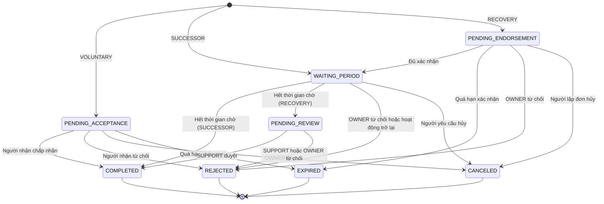

# Quản trị nền tảng và chuyển giao quyền trưởng tộc

| Thuộc tính | Giá trị |
|---|---|
| Mã tài liệu | GP-DOC-05 |
| Phiên bản | 1.0 |
| Ngày ban hành | 14/10/2026 |
| Tài liệu liên quan | GP-DOC-01 Phạm vi, GP-DOC-03 Phân quyền, ADR-0005, ADR-0008, `db/scripts/grant_system_role.sql` |

## 1. Phạm vi

Tài liệu quy định vai trò cấp hệ thống, cơ chế xác thực bổ sung cho thao tác nhạy cảm, và các quy trình chuyển giao
quyền trưởng tộc, bao gồm trường hợp trưởng tộc không còn hoạt động.

## 2. Vai trò hệ thống

| Chức năng | SYSTEM_ADMIN | SUPPORT |
|---|:-:|:-:|
| Tra cứu dòng họ (siêu dữ liệu: tên, trạng thái, OWNER, gói, số người, số thành viên) | ✓ | ✓ |
| Tra cứu tài khoản | ✓ | ✓ |
| Xét duyệt đơn khôi phục quyền trưởng tộc | ✓ | ✓ |
| Tạm ngưng, kích hoạt lại dòng họ | ✓ | ✗ |
| Khóa, mở khóa tài khoản | ✓ | ✗ |
| Cấp, điều chỉnh gói thủ công | ✓ | ✗ |
| Quản lý danh mục gói, cấu hình hệ thống | ✓ | ✗ |
| Xem nhật ký quản trị | ✓ | ✗ |
| Đọc dữ liệu gia phả của dòng họ | ✗ | ✗ |

Quy định:
- Vai trò hệ thống không mở quyền đọc dữ liệu gia phả. RLS không có ngoại lệ cho vai trò hệ thống; các hàm quản trị
  chỉ trả về siêu dữ liệu (T34).
- Vai trò hệ thống chỉ được cấp hoặc thu hồi bằng script `db/scripts/grant_system_role.sql` chạy với tài khoản
  `gp_owner`. Tài khoản `gp_app` không có quyền ghi cột `system_role` (T35).
- Mọi thao tác quản trị được ghi vào `admin_audit_log`. Thao tác tác động lên một dòng họ đồng thời được ghi vào
  audit của dòng họ đó, để OWNER biết.
- Quản trị viên không tự khóa được tài khoản của mình.

**Tạm ngưng dòng họ.** Dòng họ ở trạng thái `SUSPENDED` không truy cập được dữ liệu, kể cả OWNER và link chia sẻ;
lời mời không chấp nhận được. Thành viên vẫn thấy dòng họ trong danh sách cùng trạng thái. Dữ liệu không bị xóa.

## 3. Xác thực bổ sung (step-up)

Các thao tác chuyển giao quyền trưởng tộc yêu cầu xác thực bổ sung, ngoài access token:

1. `POST /auth/step-up` với mật khẩu hiện tại. Mật khẩu đúng: hệ thống gửi OTP 6 chữ số qua email
   (lưu SHA-256 trong `one_time_token`, mục đích `STEP_UP_OTP`, hiệu lực 10 phút, tối đa 5 lần nhập sai).
2. `POST /auth/step-up/verify` với OTP. OTP đúng: hệ thống phát hành step-up token (JWT `typ=step_up`, hiệu lực 5 phút,
   có `jti`).
3. Client gửi token trong header `X-Step-Up-Token`. Backend kiểm tra chữ ký, thời hạn, chủ thể trùng với access token,
   và đánh dấu `jti` đã dùng trong Redis (`SET NX` với TTL bằng thời hạn token) để token chỉ dùng được một lần.

Thao tác yêu cầu step-up: tạo yêu cầu chuyển giao chủ động, chấp nhận chuyển giao, yêu cầu tiếp quản, lập đơn khôi phục.

## 4. Định nghĩa "không hoạt động"

Một tài khoản được coi là không hoạt động khi ở trạng thái `LOCKED`, hoặc `last_active_at` cũ hơn
`OWNER_INACTIVE_DAYS` ngày (mặc định 180). `last_active_at` được cập nhật bằng `gp_touch_activity()` khi đăng nhập
và khi làm mới phiên; tầng ứng dụng không ghi trực tiếp được cột này (T35).

Trường hợp trưởng tộc qua đời: thành viên cung cấp giấy tờ cho SUPPORT; SYSTEM_ADMIN khóa tài khoản của trưởng tộc,
tài khoản trở thành không hoạt động và các quy trình dưới đây được áp dụng.

## 5. Quy trình chuyển giao

### 5.1. Người kế nhiệm

OWNER chỉ định một thành viên làm người kế nhiệm (`PUT /clans/{clanId}/successor`). Thông tin người kế nhiệm hiển thị
với OWNER và EDITOR. Chỉ định tự hủy khi người kế nhiệm rời dòng họ hoặc trở thành OWNER.

### 5.2. Chuyển giao chủ động (`VOLUNTARY`)

1. OWNER thực hiện step-up và tạo yêu cầu cho một thành viên.
2. Người nhận nhận email; trong `TRANSFER_ACCEPT_DAYS` ngày (mặc định 7) người nhận thực hiện step-up và chấp nhận,
   hoặc từ chối. OWNER hủy được trước khi người nhận chấp nhận.
3. Khi chấp nhận: người nhận trở thành OWNER, OWNER cũ trở thành EDITOR với phạm vi toàn dòng họ, trong cùng một transaction.

### 5.3. Tiếp quản bởi người kế nhiệm (`SUCCESSOR`)

1. Điều kiện: OWNER không hoạt động (mục 4).
2. Người kế nhiệm thực hiện step-up và gửi yêu cầu. Yêu cầu vào thời gian chờ `TAKEOVER_WAIT_DAYS` ngày (mặc định 30).
3. OWNER nhận email khi yêu cầu được tạo và email nhắc 7 ngày trước khi hết thời gian chờ.
4. Trong thời gian chờ, OWNER từ chối được yêu cầu; OWNER đăng nhập trở lại thì yêu cầu tự bị từ chối khi xử lý.
5. Hết thời gian chờ: tác vụ định kỳ `gp_process_due_transfers()` thực hiện chuyển giao.

### 5.4. Đơn khôi phục (`RECOVERY`, chức năng S04)

1. Điều kiện: OWNER không hoạt động, và không có người kế nhiệm hoặc người kế nhiệm cũng không hoạt động.
2. Một EDITOR thực hiện step-up và lập đơn, chỉ định người nhận và lý do. Người lập đơn được tính là một xác nhận.
3. Trong `RECOVERY_ENDORSE_DAYS` ngày (mặc định 14), đơn cần xác nhận của tối thiểu ⌈2/3⌉ số EDITOR của dòng họ.
4. Đủ xác nhận: đơn vào thời gian chờ như mục 5.3, có thông báo tới OWNER.
5. Hết thời gian chờ: đơn chuyển sang chờ SUPPORT xét duyệt. SUPPORT liên hệ OWNER qua thông tin đã đăng ký, đối chiếu
   giấy tờ do dòng họ cung cấp (giấy chứng tử, biên bản họp họ), và ghi lý do khi duyệt hoặc từ chối.

### 5.5. Sơ đồ trạng thái

### 5.6. Biện pháp chống chiếm quyền

| Biện pháp | Rủi ro được giảm thiểu |
|---|---|
| Step-up (mật khẩu và OTP qua email) ở mọi bước khởi tạo và chấp nhận | Access token bị đánh cắp |
| Thời gian chờ có thông báo tới OWNER; OWNER hoạt động trở lại thì yêu cầu tự hủy | Chiếm quyền khi OWNER vẫn còn hoạt động |
| Ngưỡng xác nhận ⌈2/3⌉ số EDITOR | Một EDITOR đơn phương chiếm quyền |
| SUPPORT xét duyệt cuối cùng đơn khôi phục | Nhóm EDITOR thông đồng |
| Tối đa một yêu cầu đang xử lý mỗi dòng họ | Tạo nhiều yêu cầu để gây nhiễu |
| Ghi audit mọi bước; OWNER cũ trở thành EDITOR, không bị xóa khỏi dòng họ | Thiếu truy vết; mất quyền truy cập không thể khôi phục |
| Ngưỡng thời gian chỉ thay đổi được bởi SYSTEM_ADMIN, có ghi nhật ký | Rút ngắn thời gian chờ trái phép |

## 6. Cấu hình

| Khóa | Mặc định | Ý nghĩa |
|---|---|---|
| `OWNER_INACTIVE_DAYS` | 180 | Số ngày không hoạt động để được coi là không hoạt động |
| `TAKEOVER_WAIT_DAYS` | 30 | Thời gian chờ trước khi chuyển giao do người kế nhiệm hoặc đơn khôi phục |
| `TRANSFER_ACCEPT_DAYS` | 7 | Thời hạn chấp nhận chuyển giao chủ động |
| `RECOVERY_ENDORSE_DAYS` | 14 | Thời hạn thu thập xác nhận cho đơn khôi phục |

## 7. Tác vụ định kỳ

| Tác vụ | Chu kỳ | Thực hiện bởi |
|---|---|---|
| `gp_process_due_transfers()` | 1 giờ | Backend (`gp_app`) |
| Gửi email nhắc OWNER trước khi hết thời gian chờ | 1 ngày | Backend |
| `gp_expire_pending_payments()` | 10 phút | Backend (`gp_app`) |
| Gửi email từ `email_outbox` | 10 giây | Backend |
| `gp_purge_expired_data()` | 1 ngày | Tác vụ hạ tầng (`gp_owner`) |

## Lịch sử thay đổi

| Phiên bản | Ngày | Nội dung |
|---|---|---|
| 1.0 | 14/10/2026 | Ban hành lần đầu |
